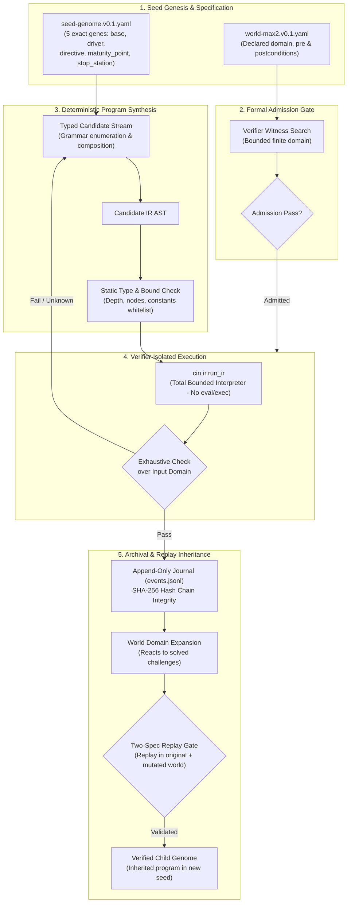

# Code in Nothing | CIN-Lab v0.1

[](https://github.com/imMamdouhaboammar/code-in-nothing/actions/workflows/ci.yml)
[](https://github.com/imMamdouhaboammar/code-in-nothing/actions/workflows/codeql.yml)

[](LICENSE)
[](https://github.com/astral-sh/ruff)
-brightgreen)

> **Mathematical evolution research extension (v0.5, proposed):** [Integrated math specification](docs/specs/2026-10-18-cin-mathematical-evolution-v0.5.md) · [research](docs/research/MATH-SYNTHESIS-RESEARCH.md) · [progressive math benchmark](docs/research/MATH-BENCHMARK-PROTOCOL.md) · [phase gates](docs/roadmap/MATH-PHASES.md) · [coding-agent continuation prompt](docs/prompts/DEEP-MATH-CODING-AGENT.md). These are **design artifacts, not newly shipped mathematical programs**.

> **Design expansion (2026-10-18):** The [integrated v0.4 system specification](docs/specs/2026-10-18-cin-integrated-system-spec-v0.4.md) and [documentation index](docs/INDEX.md) define architecture, formal contracts, research, and future phases. **No v0.4 runtime features are claimed here.** Start with [P1 milestones](docs/roadmap/PHASES.md) for the next engineering work. See the [research evidence](docs/research/LITERATURE.md) and [evaluation plan](docs/research/EXPERIMENTS.md).

A runnable **model-free evolutionary program-synthesis experiment**. This is the first practical slice of the larger [Code in Nothing v0.3 design](docs/specs/2026-10-18-cin-technical-design.md), **not** a general autonomous programmer or evidence of open-ended intelligence.

CIN-Lab starts with a five-gene YAML seed whose starting program returns its first integer argument, then explores typed code structures under a bounded formal specification. If an improved program passes independent finite-domain verification, the runtime archives it, mutates the world domain, rechecks the capability, and may create an offspring with the new program in its starting genome. The original program, verification evidence, ancestry, and end-of-life records remain traceable.

**No LLM API, local generative model, pretrained code model, network service, or task-solution prompt is involved.** CPU and memory use are real and finite. This demonstration uses **grammar enumeration and structural variation**. Evolution of mutation policies, learned abstractions, and general software engineering are not implemented.

---

## System Architecture



---

## Quickstart

Requirements: **Python 3.11+**.

### Using `uv` (Recommended)

```bash
# Clone the repository
git clone https://github.com/imMamdouhaboammar/code-in-nothing.git
cd code-in-nothing

# Validate contracts and schemas
uv run python -m cin validate

# Run test suite
uv run pytest -q

# Run baseline evolutionary synthesis experiment
uv run python -m cin demo --seed 0 --max-evals 250 --output runs/baseline
```

### Using standard `pip` and virtual environment

```bash
python3 -m venv .venv
source .venv/bin/activate
pip install -e '.[dev]'

python -m cin validate
python -m pytest -q
python -m cin demo --seed 0 --max-evals 250 --output runs/baseline
```

---

## Experiment Configurations & Controls

The CLI supports ablation controls and parameter sweeps:

| Configuration | Command | Description |
|---|---|---|
| **Canonical Baseline** | `python -m cin demo --seed 0 --max-evals 250 --output runs/baseline` | Full evolutionary pipeline with world mutation and inheritance. |
| **Frozen World Ablation** | `python -m cin demo --seed 0 --max-evals 250 --no-world-evolution --output runs/frozen-world` | Disables domain expansion; world remains static. |
| **No-Inheritance Control** | `python -m cin demo --seed 0 --max-evals 250 --no-inheritance --output runs/no-inheritance` | Prevents birth of child genome; tests baseline without replay inheritance. |
| **Short Budget Run** | `python -m cin demo --seed 3 --max-evals 50 --output runs/short-budget` | Restricts search budget to 50 candidate evaluations. |

> **Directory Overwrite Guard**: The CLI **refuses to overwrite** an existing experiment output directory. It exits nonzero on invalid inputs, infeasible world admission, or an existing output path.

### Output Artifacts

Each successful experiment run writes three deterministic artifacts to the output directory:

1. `report.json`: Metrics, search bounds, operational statistics, verification decisions, and unmeasured maturity states.
2. `events.jsonl`: Append-only, hash-chained event journal for audit, replay comparison, and tampering detection.
3. `generated_program.py`: Pretty-printed, human-readable Python translation of the verified typed IR. (This code is **never** executed by CIN-Lab; execution occurs purely inside `cin.ir`).

---

## Repository Architecture

```
code-in-nothing/
├── cin/                     # Core runtime package
│   ├── __main__.py          # CLI entry points (validate & demo)
│   ├── archive.py           # Hash-chained append-only event journal
│   ├── contracts.py         # JSON schema & five-gene genome validators
│   ├── evolution.py         # Search, lifecycle orchestration & inheritance gate
│   ├── ir.py                # Typed AST definition, bounds checker, total interpreter
│   ├── search.py            # Model-free grammar enumeration & variation
│   ├── worlds.py            # Finite-domain verifier, formula DSL & witness search
│   ├── examples/            # Packaged seed genome and world definitions
│   └── schemas/             # Packaged JSON validation schemas
├── docs/                    # Authoritative specification & research documentation
│   ├── INDEX.md             # Complete documentation roadmap and navigation index
│   ├── adr/                 # Architectural Decision Records (ADRs 0001-0003)
│   ├── architecture/        # In-depth system, contract, and security docs
│   ├── plans/               # Implementation and milestone execution plans
│   ├── research/            # Literature review and experimental methodology
│   ├── reviews/             # Formal design reviews
│   ├── roadmap/             # Milestone gates and feature phase breakdown
│   └── specs/               # Integrated v0.4 system specification & v0.3 technical design
├── examples/                # Standalone YAML genome seeds & world specifications
├── experiments/             # Pre-computed verified reference run artifacts
├── schemas/                 # Formal JSON Schemas (Draft 2020-12)
├── tests/                   # Focused unit tests and CLI integration tests
├── .github/                 # GitHub Actions workflows & issue/PR templates
├── CITATION.cff             # Academic citation metadata
├── CONTRIBUTING.md          # Architectural boundaries & contribution guidelines
├── LICENSE                  # Apache License 2.0
├── pyproject.toml           # Package metadata, dependencies, and tooling configuration
└── SECURITY.md              # Threat model, sandbox boundaries, and disclosure policy
```

---

## Implementation Map

| Module | Core Responsibility |
|---|---|
| `cin/contracts.py` | Enforces five-gene YAML and formal world schemas, including semantic domain bounds. |
| `cin/ir.py` | Typed AST validation, total bounded interpreter, canonical hashing, safe Python export. |
| `cin/search.py` | Deterministic, model-free typed candidate enumeration and parent subtree variation. |
| `cin/worlds.py` | Formula evaluation DSL, finite-domain verification, witness admission, domain mutators. |
| `cin/evolution.py` | Lifecycle coordination, growth verification, two-spec replay inheritance gate, child birth. |
| `cin/archive.py` | Single-process append-only journal with SHA-256 hash-chain tamper detection. |
| `cin/__main__.py` | CLI driver for schema validation and demonstration experiments. |

---

## Demonstrated Behavior vs. Research Goals

| Capability / Behavior | Current Status |
|---|---|
| Five exact genome genes, strictly no sixth gene | **Implemented and tested** |
| Model-free typed candidate generation | **Implemented and tested** |
| Finite-domain world witness admission | **Implemented and tested** |
| Independent behavioral checking before accepting growth | **Implemented and tested** |
| World domain expansion reacting to solved challenges | **Implemented and tested** |
| Two-spec replay inheritance gate (original + mutated world) | **Implemented and tested** |
| Immutable maturity and stopping criteria on child | **Implemented and tested** |
| Deterministic replay of normalized outcomes | **Implemented and tested** |
| Hash-chained journal audit trail | **Implemented and tested** |
| Semantic task synthesis via co-evolving environments | *Future Research (P1)* |
| Learned reusable abstractions spanning distinct task families | *Future Research (P2)* |
| Multi-epoch population scheduling & selection | *Future Research (P3)* |
| Adaptable and self-modifying growth driver policies | *Future Research (P4)* |
| Hidden transfer benchmark suite & statistical evaluation | *Future Research (P5)* |

---

## Security & Scientific Evidence Boundaries

- **Pure Data AST**: Generated IR is structured data. The interpreter (`cin.ir.run_ir`) executes only whitelisted operations and never accesses Python builtins, imports, filesystem, network sockets, or subprocesses.
- **Finite-Domain Scope**: Verification is exhaustive **only over declared finite integer intervals**. It does not constitute an inductive proof for unbounded domains.
- **Verifier Witness Isolation**: The verifier searches for a witness program to establish task feasibility during admission. The organism **never receives the witness**; only the witness digest is recorded in the journal.
- **Audit Logs**: Archive integrity utilizes SHA-256 hash chaining. It provides internal replay consistency checks, not cryptographic distributed consensus.

---

## Documentation Index

Explore the complete system specification and research documents:

- [`docs/INDEX.md`](docs/INDEX.md): Master documentation guide.
- [`docs/specs/2026-10-18-cin-integrated-system-spec-v0.4.md`](docs/specs/2026-10-18-cin-integrated-system-spec-v0.4.md): Integrated v0.4 system specification.
- [`docs/architecture/SYSTEM.md`](docs/architecture/SYSTEM.md): System architecture and data flow.
- [`docs/architecture/CONTRACTS.md`](docs/architecture/CONTRACTS.md): Formal contract definitions.
- [`docs/research/LITERATURE.md`](docs/research/LITERATURE.md): Related academic literature and theoretical grounding.
- [`docs/research/EXPERIMENTS.md`](docs/research/EXPERIMENTS.md): Experimental methodology and evaluation plans.
- [`docs/roadmap/PHASES.md`](docs/roadmap/PHASES.md): Research roadmap from P1 to P5.

---

## Citation

If you use or reference Code in Nothing in your research, please cite:

```bibtex
@software{cin_lab_2026,
  author = {Aboammar, Mamdouh},
  title = {Code in Nothing (CIN-Lab): Model-Free Bounded Evolutionary Program-Synthesis Research Prototype},
  url = {https://github.com/imMamdouhaboammar/code-in-nothing},
  version = {0.1.0},
  year = {2026}
}
```

See [`CITATION.cff`](CITATION.cff) for complete citation metadata.

---

## License

This project is licensed under the [Apache License, Version 2.0](LICENSE).
