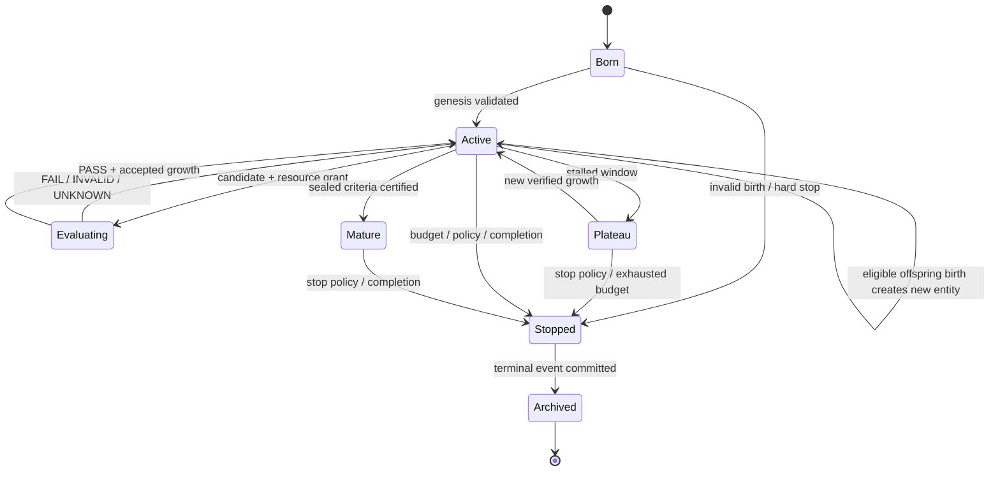
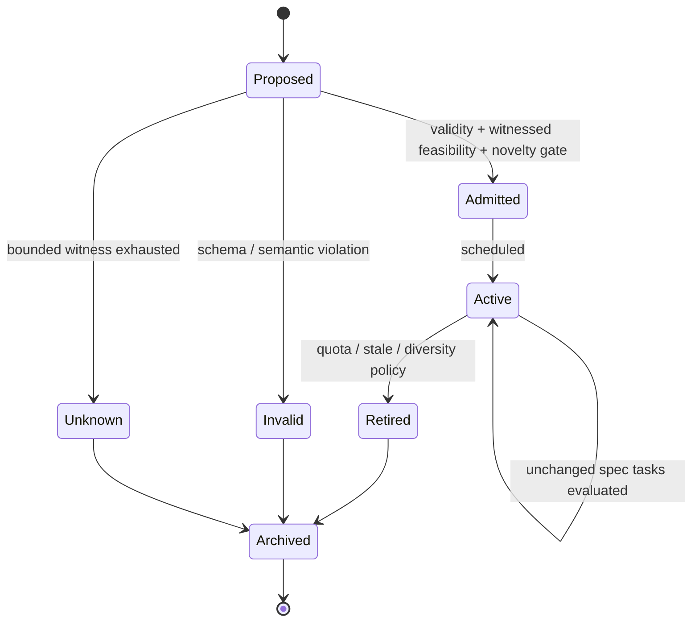

# Hybrid evolution protocol

**Status:** v0.4 proposed protocol; v0.1 demonstrates one bounded synthesis and offspring event only. Normative invariants are in the [integrated specification](../specs/2026-10-18-cin-integrated-system-spec-v0.4.md).

## 1. Life, population and the five genes

**Individual development** changes the accepted phenotype of an organism during its finite lifetime. **Generational evolution** makes new organisms with inherited, independently replayed capabilities. Neither guarantees progress. A world population runs a separate challenge-evolution loop. World metadata never becomes a sixth organism gene.

A proposal can be purely syntactic (no useful change), behaviorally equivalent (possibly cheaper), functionally novel (solves different spec) or harmful. Only verified promotion counts as growth. Distinguish these outcomes in reporting.

## 2. Organism lifecycle (target)



Every state transition is emitted once to the event ledger. `Mature` is a certification state; it does not imply infinite survival, and `Stopped` does not imply failed research. Terminal means no further proposals or offspring from the terminated instance; inherited skills remain valid artifacts according to their own scope.

## 3. World lifecycle (target)



A proposed world that the verifier cannot solve in its budget is `UNKNOWN`, not `REJECTED as impossible`. Its parent remains unchanged. A mutated world is a new immutable entity; a previous world may stay active in another niche.

## 4. Growth algorithm proposal

```text
For each scheduler-approved organism/world pair:
  1. Reserve finite proposal + interpreter + verifier budgets.
  2. Admit/locate immutable world specification and its checked scope.
  3. Select a bounded mutation policy from active driver configuration.
  4. Produce a candidate CIN-IR tree, canonicalize, type-check and dedupe.
  5. Independently evaluate the new candidate; charge each attempt.
  6. Replay previously retained capabilities and their dependencies.
  7. Promote only if PASS, no regression, and measurable contribution.
  8. Append certificate + parent digest; update phenotype pointer atomically.
  9. Optionally propose an offspring with inherited, replayed artifacts.
  10. Check maturity, plateau and stopping criteria; archive if terminal.
```

**Current caveat:** In v0.1 proposal weights and meta-mutation policy fields are declarative. `candidate_stream` is deterministic bounded search, not self-tuning search. The pilot finds MAX2 but does not independently demonstrate increased general-purpose discovery efficiency.

## 5. Selection and diversity

Individual ranking is **Pareto-aware** across verified task coverage, search operations per solved task, replay safety and structural/semantic diversity. A single scalar reward must not collapse validity into a tradeable score: correctness is a non-negotiable admission gate. Within verified participants, a MAP-Elites-like archive *may* cover measured behavior descriptors (task family, output sensitivity, code size/cost), but only after meaningful descriptors and fair baselines are tested.

For niche selection, report the fraction of occupied *predeclared* descriptor cells and unique semantic tasks. Multiple ASTs computing MAX2 do not count as separate skills. Avoid niche descriptors that can be gamed by expanding code or choosing arbitrary task names.

## 6. World pressure, learnability and novelty

World fitness is not simply organism failure rate. An admitted world must pose a feasible, non-vacuous and independently verified relation. Among admitted worlds, favor challenge distinction, useful difficulty range and diversity of new behavior. Novelty should use equivalence checks or distinguishing counterexamples over a common domain; `world_id` and enlarged input bounds are insufficient.

Proposed first semantic world mutations:

| Parent task | Mutation | Novel behavior criterion |
| --- | --- | --- |
| `max(x,y)` | `min(x,y)` with a separately verified relation | Different output on some shared input pair |
| `max(x,y)` | bounded `x+y` with explicit overflow/bit conditions | Distinct task-family semantics and independent witness |
| `min/max` | piecewise combination under a declared condition | Distinguishing counterexample; typed/witnessed formula |

Adding new task families requires domain definitions and proof methodology. No list/string tasks are valid until the type system supports them. The proposal generator must not see verifier-private reference implementations.

## 7. Hereditary promotion

`Capability` is a versioned IR artifact bound to a semantic task. It is inheritable only if the child can evaluate it under the active grammar/limits, every dependency is available and replay succeeds against the target task contracts. This is a *mechanical* transfer. **Research-valid cross-task reuse** requires a separate claim: at least one verified abstraction used as a subprogram in two distinct functional tasks, plus an ablation showing the abstraction improves search vs removing it at matched budget.

A lineage reference is not a proof; a certificate does not carry over automatically when the input/output semantics, verifier version, limits or grammar change. Perform version-scoped revalidation.

Policy inheritance is stricter: a changed driver must be compared to its parent policy over identical task suites and budgets, and may be promoted only with no safety regression. Children born from policies are distinct organisms; parent contracts remain immutable.

## 8. Maturity and stop semantics

**Maturity criteria** are fixed at birth and evaluated independently: minimum verified *semantic* tasks and families, withheld transfer fraction, reused abstractions, regression-free replay and accounted budget. Evaluation can return `CERTIFIED`, `NOT_CERTIFIED` or `NOT_EVALUATED`. `NOT_EVALUATED` must never be shown as success.

**Stop criteria** are independent: hard evaluation budget, maximum epochs, plateau count, governor violation, externally ordered completion. `STOPPED` is terminal and archival must be idempotent. The actual v0.1 one-cycle demonstration ends with `EXPERIMENT_COMPLETE`; it does not yet implement the full epoch and plateau runtime promised by the declarative YAML.

## 9. Failure and adversarial checks

| Failure | Required outcome |
| --- | --- |
| Mutation creates ill-typed AST or unknown op | `INVALID`, do not run or promote |
| Candidate passes a trivial train sample but fails domain verification | `FAIL`, preserve counterexample and exact scope |
| Candidate exhausts IR ops or resource governor | `UNKNOWN` or terminal budget stop; never PASS |
| World has unsatisfiable or empty admitted precondition | `INVALID`/`REJECTED`, never a vacuous PASS |
| Witness search budget exhausted | Admission `UNKNOWN`, no world promotion |
| World only changes numeric bounds | robustness extension, not new functional capability |
| Child receives forged certificate | Birth rejected after independent replay |
| Parent policy attempts to edit benchmark | Reject mutation and stop according to trust policy |
| Crash between promotion and offspring birth | Resume from durable event boundary; no duplicate promotion or birth |
| Maturity not assessed | `NOT_EVALUATED`, even if high training score |

## 10. Measurable progress vs narrative

Growth count: accepted new *semantic* tasks. Heredity count: children with independently replayed capabilities. Abstraction benefit: withheld-task success and candidate/operation costs with vs without reusable component. World innovation: admitted functionally different challenge relations. Meta-growth: reproducible benefit from policy variants on tasks absent from policy selection. Zero-LLM calls is an instrumentation fact, not evidence of autonomy or free computing.
