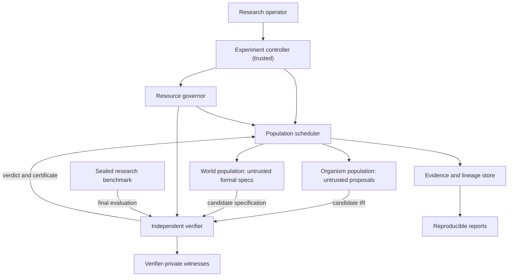
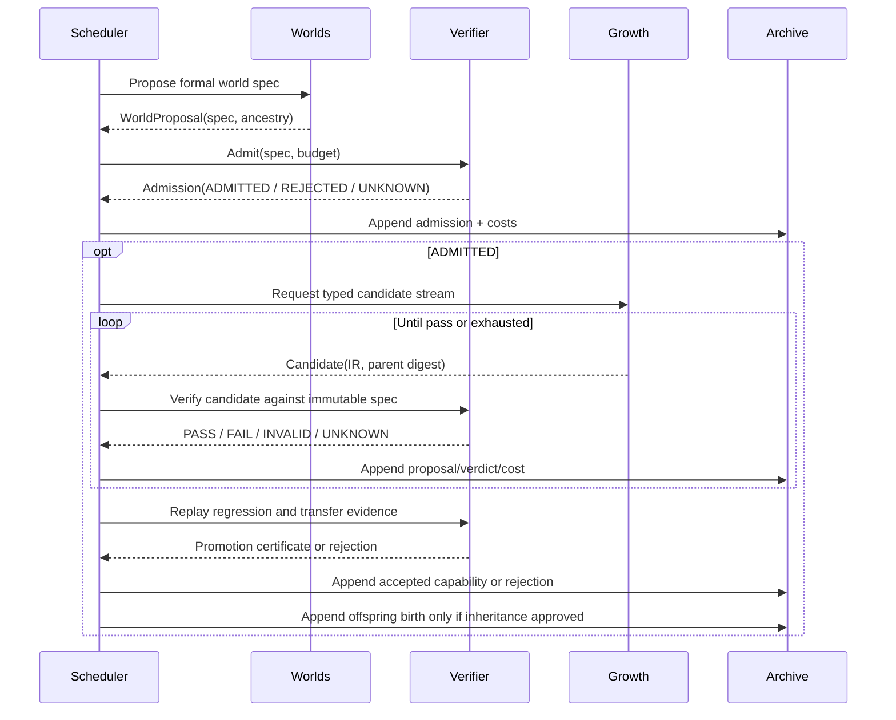

# CIN system design and architecture

**Status:** Proposed target architecture layered over the existing v0.1 modules. See [integrated specification](../specs/2026-10-18-cin-integrated-system-spec-v0.4.md) and [contracts](CONTRACTS.md).

## 1. Context and trust boundaries

**Present state:** one trusted Python process with data-only IR, `cin/` modules and JSONL. The diagram describes **ownership and proposed flows**, not already-deployed isolated services. The `Private` and `Holdout` stores are prospective boundaries; current witness hashes are logged and the current benchmark is not sealed.

## 2. Current modules and their real contracts

| Existing file | Responsibility now | Not its responsibility |
| --- | --- | --- |
| `cin/contracts.py` | Load/validate genome and world, reject invalid grammar and spec | World-family semantics across heterogeneous tasks |
| `cin/ir.py` | Validate and run bounded pure typed expression, canonical hashes, readable export | OS sandbox, arbitrary Python execution |
| `cin/search.py` | Enumerate/select proposals under an explicit budget | Learned mutation policy or neural search |
| `cin/worlds.py` | Check formula over declared finite domain, witness admission, domain expansion | Distinct functional family generation or universal SMT proof |
| `cin/evolution.py` | Run one growth slice, verify inheritance after replay, terminal archive | Persistent multi-epoch population and driver evolution |
| `cin/archive.py` | Append hash-chained JSONL events and check chain | Multi-process transaction log, authenticity, crash recovery |
| `cin/__main__.py` | Validate and run demo CLI | Production service or autonomous external integrations |

## 3. Target bounded contexts and ports

Keep the implementation a **modular monolith** with named ownership. New modules are created only as acceptance tests require them.

| Target owner | Inputs | Outputs | State owned | Proposed seam |
| --- | --- | --- | --- | --- |
| Genesis | Valid seed and approved inheritance | Immutable organism birth artifact | Genome snapshots | `birth(genome, parents) -> BirthDecision` |
| Growth | Birth phenotype, world tasks, budget | Typed candidate proposals | Per-organism search policy and cursor | `propose(organism, task, budget) -> Iterator[Candidate]` |
| Worlds | Admitted parent world, grammar, budget | Candidate formal specification | World evolution policies/ancestry | `propose_world(world, budget) -> WorldProposal` |
| Verifier | Immutable candidate/spec refs and scope | Typed certificate/verdict | Reference evaluator and hidden witness | `verify(candidate, spec, budget) -> Verdict` |
| Scheduler | Population registry, world registry, governor | Deterministic state transitions | Epoch, queue, RNG state | `advance(cohort) -> Events` |
| Archive | Immutable events/artifacts | Content references/replay snapshots | Event log and artifact DAG | `append(event)` and `checkpoint(snapshot)` |
| Research controller | Frozen experiment plan | Matched control allocations and reports | Cohort ID, outcomes, holdout release | `run_cohort(plan) -> CohortReport` |
| Governor | Work request and external quotas | Grant/deny/terminate with reason | Resource budget counters | `reserve()/charge()/terminate()` |

Dependency rule: `Scheduler -> domain ports -> implementations`; organisms and worlds cannot import or update verifier decisions. Candidate proposals are data, not executable callbacks into trusted code. Archive records facts from the decision authority; it does not decide acceptance.

## 4. Primary successful interaction

Admission witness remains private to the verifier and cannot be used as a candidate payload. The experiment controller freezes challenge signatures and evaluator version before the cohort starts.

## 5. Domain aggregate model

- **Cohort** (`cohort_id`, frozen experiment configuration and fingerprints): root of a comparable experimental run.
- **Organism** (`organism_id`, genome reference, phenotype versions, parent refs, state, budget ledger): never overwrites its parent.
- **World** (`world_id`, immutable spec hash, family, parent refs, state, admission evidence): any mutation creates a new ID and hash.
- **Capability** (semantic task ID, expression hash, proof-scope refs, replay dependencies): not equivalent to world ID or spec hash.
- **Candidate** (expression hash, source organism, proposed operator, parent hash and proposal number): immutable, untrusted until checked.
- **Certificate** (exact subject, spec, evaluator, scope, verdict, costs, artifact digest): typed proof of a bounded claim.
- **Heritage bundle** (approved capability refs and dependency closure, policy refs, parent IDs): candidate for reproduction, not automatic authority.
- **Life record** (birth, growth, plateau, maturity attempt, stop reason, archive hash): append-only event sequence.

Uniqueness is enforced at the **artifact** level by content digest and at the **semantic task** level by independently verifiable behavior. Identity strings alone are labels.

## 6. Scheduler ownership and deterministic ordering

**Proposed:** At each epoch the controller selects a world/organism pair using a versioned policy and pinned RNG; governor grants capacity; worlds are admitted; candidate budgets are consumed; verifier decides promotions; scheduler schedules reproduction; archive transactionally persists events. Selection and execution must not race across shared mutable records in the first implementation.

Stable ordering of equal-priority records: `cohort_id`, `epoch`, `world_id`, `organism_id`, `proposal_index`. A deterministic mode uses exactly one worker, canonical serialization and recorded PRNG state. Parallel mode may be added later with a declared nondeterminism contract; merely seeding Python is insufficient to guarantee identical order under concurrency.

## 7. Storage and failure recovery

| Concern | v0.1 reality | First future step (P1) |
| --- | --- | --- |
| Events | JSONL append chain | SQLite transactionally committed event stream, or equivalently tested single-writer journal |
| Artifact location | Inline report/program & event hashes | Content-addressed JSON under a controlled local root |
| Crash recovery | Not supported | Checkpoint epoch, cursor, RNG state and remaining budget; restart exact decision boundary |
| Idempotence | Terminal archival per in-memory organism | Stable event identity prevents duplicate birth/promotion after restart |
| Partial writes | Not hardened for all failures | Flush transaction then publish checkpoint atomically |
| Replay | Compare normalized result and hash chain | Replay from frozen manifest and history with versions |

Avoid introducing SQLite until the first multi-generation acceptance test demonstrates that restart is essential; one persistent owner is preferable to distributed infrastructure. Avoid storing secrets or hidden holdouts in organism-readable artifacts.

## 8. Versioned interfaces and migration

The public v0.1 CLI stays stable. New policy/event schema IDs use explicit versions; no automatic reinterpretation of prior hashes. A compatibility adapter may *read* prior v0.1 artifacts but must not silently upgrade evidence scope from finite `PASS` to universal validity. Migration into any new store includes a count reconciliation, chain validation and immutable legacy manifest. See [CONTRACTS.md](CONTRACTS.md).

## 9. Deployment decisions

Local research process and offline dependencies are the default. A separate OS-isolated execution worker is mandatory before any future arbitrary generated source or host mutation. A web app, hosted APIs, queue or distributed workers add no research value until P1-P5 evidence identifies concrete pressure. Follow [ADR-0003](../adr/0003-single-process-first.md).
