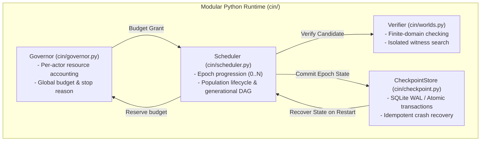

# Deep Research & Architectural Evaluation: The Next Horizon for CIN-Lab

**Date:** 2026-10-18  
**Scope:** Phase P1 Transition (Multi-Epoch Lifecycle, Search Space Pruning & Modular Architecture)  
**Frameworks Applied:** `/research`, `/agency-search-relevance-engineer`, `/fable-discover`, `/fable-architecture`

---

## 1. Fable-Discover: Repository Topology & Execution Path Tracing

### 1.1 Measured Runtime Flow (Baseline Pilot P0)

```
cin/__main__.py (CLI Driver)
  └── load_genome() & load_world() (cin/contracts.py: Schema validation)
        └── Archive(output_dir) (cin/archive.py: SHA-256 Chained Event Log)
              └── Experiment.run() (cin/evolution.py: 1-epoch lifecycle)
                    ├── admit_world() (cin/worlds.py: Verifier-private witness search)
                    ├── candidate_stream() (cin/search.py: Grammar enumeration)
                    ├── check_tree() (cin/ir.py: Static IR constraints)
                    ├── verify_program() (cin/worlds.py: Exhaustive finite-domain check)
                    ├── expand_domain() (cin/worlds.py: Domain mutation)
                    ├── spawn_verified() (cin/evolution.py: Two-spec replay gate)
                    └── write_report() (Deterministic JSON metadata)
```

### 1.2 Load-Bearing Unknowns vs. Measured Facts

| Question | Classification | Measured Status & Evidence |
|---|---|---|
| **Can the current runner execute $>1$ generation?** | `[Load-bearing]` | **No.** `cin/evolution.py` only instantiates a single `Experiment` with 1 parent and at most 1 child. It halts with `EXPERIMENT_COMPLETE`. |
| **Is state preserved across process interruptions?** | `[Load-bearing]` | **No.** Partial runs do not persist transactional checkpoints; terminating mid-search discards candidate evaluation progress and requires re-running from scratch. |
| **Is the search space metered across all operations?** | `[Load-bearing]` | **Partial.** Organism candidate evaluations are metered (`max_evals`), but verifier witness search compute during world admission (`admit_world`) is not deducted from the organism's budget ledger. |
| **Are world tasks semantically distinct?** | `[Measured]` | **No.** World mutation currently consists of domain interval expansion (`x: [-2, 2] -> [-4, 4]`); the underlying relation remains strictly MAX2. |

---

## 2. Search Relevance Engineering: Program Synthesis as an IR Retrieval Problem

In classical search, bad search is a recall problem wearing a ranking costume. In program synthesis, the same law applies: **synthesizer failure is a search-space recall & redundancy problem wearing a search-time costume**.

### 2.1 The Combinatorial Recall Dilemma

Currently, `cin/search.py` generates proposals via naive grammar cartesian products:

$$\text{Proposals} = |\text{Leaves}| + 2 \times |\text{Leaves}|^2 + 2 \times |\text{Leaves}|^4 + \text{Parent Combinations}$$

Evaluating 85 candidates for a 2-variable `max(x, y)` problem completes in $\approx 20\text{ms}$. However, moving to Phase P2 (new task semantics: `min`, `clamp`, `bounded_add`) and Phase P3 (macro reuse) causes a combinatorial explosion ($O(b^d)$) that exhausts search budgets without discovering valid witnesses.

### 2.2 Search Relevance Solutions for Program Induction

```
[Candidate Generator]
         │
         ▼
┌─────────────────────────────────┐
│   1. Equivalence Normalizer     │  <-- Prunes semantic duplicates (Add(a,b) == Add(b,a))
└─────────────────────────────────┘
         │
         ▼
┌─────────────────────────────────┐
│   2. Type & Constant Filter     │  <-- Enforces static reachability
└─────────────────────────────────┘
         │
         ▼
┌─────────────────────────────────┐
│   3. Offline Judgment Set       │  <-- Golden benchmark tasks to score search recall@budget
└─────────────────────────────────┘
         │
         ▼
[Finite-Domain Verifier]
```

1. **Equivalence & Symmetry Pruning (Recall without Noise)**:
   - Commutative collapse: Treat `Add(a, b)` and `Add(b, a)` as an identical canonical key.
   - Trivial relation elimination: Eliminate `LessThan(a, a)` (always false) and `Equal(a, a)` (always true).
   - Identity pruning: Filter out `Add(x, 0)` or `Sub(x, 0)` from spawning deeper subtrees.
2. **Offline Evaluation via Golden Judgment Sets**:
   - Establish a pre-registered benchmark of 10 formal finite-domain tasks (MAX2, MIN2, CLAMP, ABS_DIFF, SIGN).
   - Track `Recall@K` (percentage of benchmark tasks solved within $K=100, 250, 500$ evaluations) across multiple random seeds.
   - Treat any heuristic or mutation tweak as a relevance change: score against the Golden Set in CI before merging.

---

## 3. Fable-Architecture: 3-Vector Inception Evaluation

To determine whether the next step requires distributed microservices or a modular monolith:

### 3.1 Vector Scoring

| Vector | Score (0–10) | Empirical Rationale |
|---|---|---|
| **Vector 1: Scale & Load** | **2.0** | Single-node research execution. No external network clients, web traffic, or real-time concurrent sockets. Target workload is deterministic batch execution. |
| **Vector 2: Domain Decoupling** | **5.0** | Subsystems have clear bounded responsibilities (Verifier vs. Scheduler vs. Governor vs. Archive), but they share in-memory AST representations without network boundaries. |
| **Vector 3: Resource Intensity** | **4.0** | Pure CPU-bound AST evaluation and finite-domain checking, paired with light disk I/O for append-only journals. |

$$\text{Composite Score} = (0.35 \times 2.0) + (0.40 \times 5.0) + (0.25 \times 4.0) = 0.70 + 2.00 + 1.00 = \mathbf{3.70} / 10$$

### 3.2 Verdict & Architectural Constraint

$$\mathbf{3.70 < 6.0} \quad \text{and all individual vectors} < 7.0 \implies \mathbf{Verdict: \text{Monolith}} \ (\text{allowMonolith: true})$$

- **Hard Boundary**: Distributed microservices (message brokers, gRPC daemon clusters, API gateways) are **formally locked out**.
- **Alignment with ADR-0003**: ADR-0003 specifically dictates: *"Keep research scheduling, state transitions and evidence collection in one Python runtime using explicit internal ownership boundaries... Introduce distribution only after measured bottlenecks and verified recovery semantics."*
- **Architecture Choice**: **Clean Hexagonal Architecture within a Modular Monolith**, backed by a transactional embedded state engine (Python standard library `sqlite3` in WAL mode).

---

## 4. The Recommended Next Step: Executing Phase P1 (P1-01 & P1-02)

The immediate next engineering milestone is **Phase P1: Deterministic Multi-Epoch Evolution with Durable Evidence**.



### 4.1 Detailed Implementation Checklist for P1

1. **`cin/governor.py` (`P1-01`)**:
   - `Cost` dataclass (`candidate_evals`, `witness_evals`, `cpu_ms`, `ir_steps`).
   - `Governor.reserve(actor_id, proposed_cost) -> Grant`.
   - `Governor.charge(grant, actual_cost) -> BudgetSnapshot`.
   - Enforce account ceilings across world admission and organism search.

2. **`cin/scheduler.py` (`P1-02`)**:
   - Multi-generation cohort manager (`max_epochs`, `population_size`).
   - Generational DAG tracking (parent -> offspring with immutability contracts).
   - Plateau handling and terminal idempotence (no action after death).

3. **`cin/checkpoint.py` (`P1-03`)**:
   - Transactional persistence using Python stdlib `sqlite3` (WAL mode).
   - Atomic commit of epoch events and manifest hashes.
   - Crash recovery test: injecting a process abort between promotion and birth guarantees zero duplicate offspring.
