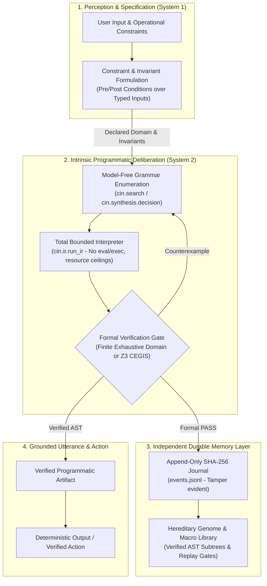

# Intrinsic Programmatic Deliberation & Weightless Continual Adaptation

**Status:** Research Horizon & Architectural Blueprint (`HYPOTHESIS` / `DESIGNED`)  
**Runtime Grounding:** CIN-Lab v0.1 (`cin.ir`, `cin.search`, `cin.worlds`, `cin.archive`, `cin.evolution`)  
**Scope:** Formalization of pre-utterance programmatic deliberation, durable non-volatile memory, and test-time algorithmic adaptation without gradient retraining.

---

## 1. Executive Summary & Core Research Thesis

Current state-of-the-art conversational artificial intelligence relies predominantly on **autoregressive next-token prediction**: generating sequential language tokens where reasoning is simulated as an emergent byproduct of likelihood maximization over a fixed context:

$$\max_\theta \sum_{t=1}^T \log P_\theta(w_t \mid w_{<t})$$

While Chain-of-Thought (CoT) prompting encourages intermediate token emission, this process remains fundamentally **token-simulated thought**. Errors cascade monotonically across token steps ($O(L)$ error drift), memory is bounded by ephemeral context windows and lossy key-value (KV) caches, and adapting behavioral policies requires costly, catastrophic-forgetting-prone gradient backpropagation runs costing millions of dollars in compute.

**The CIN Research Thesis:**  
The transition from simulated verbal reasoning to **intrinsic deliberation before utterance** requires decoupling the *internal compute engine* from the *token emission channel*. By framing deliberation as **resource-bounded, model-free program synthesis over typed Abstract Syntax Trees (ASTs)**, an agent can:

1. **Deliberate Prior to Utterance (System 2 Engine):** Synthesize, execute, and formally verify discrete algorithmic hypotheses against strict domain invariants before any visible token is committed.
2. **Maintain Independent, Durable Memory:** Store verified procedures and discovered macro-abstractions in immutable, hash-chained hereditary genomes and macro registries, completely decoupled from volatile context windows.
3. **Execute Weightless Continual Adaptation:** Adapt operational policies dynamically during runtime in milliseconds by synthesizing provably correct AST modifications, bypassing multi-million-dollar gradient retraining entirely.

---

## 2. Theoretical Paradigm Contrast

The table below contrasts the autoregressive token-generation paradigm with the model-free programmatic deliberation paradigm:

| Dimension | Autoregressive Token Simulation (Status Quo) | Intrinsic Programmatic Deliberation (CIN Horizon) |
| :--- | :--- | :--- |
| **Primary Medium of Thought** | Sequential natural-language tokens in communication channel | Discrete typed AST expressions in a closed, total interpreter (`cin.ir`) |
| **Verification Gate** | Post-hoc heuristic or external reward model (unverified) | Exhaustive finite-domain or SMT/Z3 counterexample verification (`cin.worlds`, `cin.synthesis.cegis`) |
| **Error Dynamics** | Compounding failure rate over length $L$: $P(\text{fail}) \ge 1 - (1 - \epsilon)^L$ | Zero-defect guarantee over declared verification domain $\mathcal{D}$; invalid candidates are pruned prior to emission |
| **Memory Substrate** | Ephemeral context window, volatile KV cache, lossy vector retrieval | Append-only, SHA-256 hash-chained provenance journal (`events.jsonl`) and verified hereditary genome (`seed-genome.yaml`) |
| **Policy Adaptation Mechanism** | Stochastic Gradient Descent (SGD) fine-tuning ($\Delta \theta = -\eta \nabla_\theta \mathcal{L}$) or prompt injection | Inductive synthesis of discrete AST subtrees / decision trees during test-time execution |
| **Continual Learning Cost** | $10^5$–$10^7$ USD in GPU cluster hours; high risk of catastrophic forgetting | $\sim 10$–$500$ ms CPU search; strictly zero catastrophic interference on existing verified macros |

---

## 3. Architecture of Intrinsic Deliberation



### 3.1 Decoupling Deliberation from Utterance

In standard LLM decoding, the model reasons while emitting tokens. If a token leads to a mathematical contradiction three tokens later, the model cannot backtrack; it must hallucinate or generate plausible rationalizations.

In CIN's deliberation framework:
1. The conversational front-end parses human intent into an operational contract $\Phi = (\text{Pre}, \text{Post})$ over input domain $\mathcal{D}$.
2. The internal deliberation engine searches for a candidate expression $P \in \mathcal{G}$ such that:
   $$\forall \mathbf{x} \in \mathcal{D}, \quad \text{Pre}(\mathbf{x}) \implies \text{Post}(\mathbf{x}, P(\mathbf{x}))$$
3. Search and candidate evaluation occur entirely within the closed interpreter `cin.ir.run_ir`. Candidate failures, counterexamples, and rejected branches consume finite CPU budget without leaking unverified tokens into the interaction stream.
4. Only when a candidate achieves `PASS` (either via exhaustive finite-domain evaluation or symbolic proof) is the verified logic committed.

---

## 4. Breaking the "Frozen Weights" Impasse: Real-Time Structural Self-Evolution

### 4.1 The Unsustainable Retraining Treadmill

Modern foundation artificial intelligence is currently trapped in the **"frozen weights" dilemma**:
1. **Static Post-Deployment Parameters:** Once pre-training and fine-tuning complete, the dense weight tensor $\theta \in \mathbb{R}^D$ is frozen. The model cannot alter its internal structure during inference.
2. **The In-Context Learning Illusion:** Prompt engineering and in-context examples do not update model knowledge or operational logic; they merely modulate activation paths through fixed weights. The moment the session ends or the context window shifts, all "learned" behavior vanishes.
3. **The Multi-Million-Dollar Retraining Cycle:** To permanently update capabilities, resolve systematic failures, or absorb new world constraints, organizations must launch multi-million-dollar training runs over massive GPU clusters. This process takes weeks, consumes gigawatt-hours of energy, and introduces severe **catastrophic forgetting**—where updating the network to solve new tasks degrades its reliability on previously mastered domains.

The AI field requires a fundamental paradigm shift: **a model that develops and evolves itself autonomously in real time**, continuously adapting its internal logic during live interaction without requiring periodic offline retraining runs.

### 4.2 Software-Driven Structural Plasticity (The CIN Approach)

CIN resolves this impasse by replacing opaque, frozen floating-point matrices with **discrete, verifiable programmatic structures**:

$$\mathcal{M} = \langle \mathcal{T}_{\text{AST}}, \mathcal{G}_{\text{genome}}, \mathcal{L}_{\text{macros}} \rangle$$

- **Typed Abstract Syntax Trees ($\mathcal{T}_{\text{AST}}$):** Executable, inspectable expressions operating in a closed, total interpreter (`cin.ir`).
- **Five-Gene Hereditary Genome ($\mathcal{G}_{\text{genome}}$):** Formal policy genes (`base`, `driver`, `directive`, `maturity_point`, `stop_station`) that govern candidate exploration, bounds, and termination.
- **Composable Macro Registry ($\mathcal{L}_{\text{macros}}$):** A growing library of verified subroutines that can be composed into higher-order algorithms.

Rather than running stochastic gradient descent across billions of continuous parameters, CIN achieves **real-time structural self-evolution**:
- When the agent encounters a new operational constraint or an environmental change, it executes an inductive synthesis loop (`cin.synthesis.cegis` or `cin.search`) in milliseconds.
- The model directly modifies its internal AST compositions, branch predicates, or genetic policies.
- These modifications are **active immediately** in the current interaction session, providing instantaneous plasticity on standard CPU hardware.

### 4.3 Success-Conditioned Adaptation in Mutating Environments

Unchecked self-modification risks behavioral degradation or catastrophic divergence. CIN enforces strict safety and stability through **success-conditioned environmental evolution**:

1. **Environmental Mutation (`cin.worlds`):** When an agent solves a task, the environment evolves—expanding its domain bounds or introducing stricter behavioral invariants.
2. **Search for Structural Adaptations:** The agent searches for structural variations of its active program that satisfy the new challenge.
3. **The Two-Spec Replay Gate:** A structural modification is admitted into durable memory **only if it passes verification on both**:
   - The original baseline world $W_0$ (preventing regression / catastrophic forgetting).
   - The newly mutated world $W_1$ (confirming genuine adaptation to new conditions).
4. **Hereditary Birth & Archive Commitment:** Once validated, the modified program is sealed into the append-only SHA-256 provenance journal (`events.jsonl`) and becomes the seed genome of the next generation or active operational profile.

### 4.4 Paradigm Comparison: Gradient Retraining vs. Real-Time Structural Adaptation

| Dimension | Foundation LLM Retraining Cycle | CIN Real-Time Structural Self-Evolution |
| :--- | :--- | :--- |
| **Adaptation Speed** | Days to weeks of offline batch training | $10$ to $500$ milliseconds during live interaction |
| **Hardware Required** | Thousands of high-end GPUs / TPUs ($10^5$–$10^7$ USD) | Single commodity CPU core ($< 1$ Watt-hour) |
| **Weight Substrate** | Frozen continuous tensor $\theta \in \mathbb{R}^D$ | Mutable, typed ASTs and hereditary policy genes |
| **Catastrophic Forgetting** | High risk; requires replay buffers and dataset mixing | Zero; verified past programs are cryptographically sealed |
| **Auditability & Explainability**| Statistical black box; impossible to verify single weights | Exact mathematical proof / AST inspection with SHA-256 trail |
| **Environmental Coupling** | Passive; trained on static historical data scrapes | Active; evolves directly against mutating formal worlds |

---

## 5. Independent and Durable Memory Substrate

Language model memory is currently divided between two unsatisfactory extremes:
1. **Volatile In-Context Working Memory:** Ephemeral, expensive ($O(N^2)$ or $O(N)$ attention compute per generation), subject to context-window truncation.
2. **Static Pretrained Weights:** Frozen at training cut-off, impossible to inspect directly, unmodifiable without fine-tuning.

CIN establishes a third paradigm: **an independent, auditable, executable memory hierarchy**:

```
+-------------------------------------------------------------+
|                  Independent Memory Layers                  |
+-------------------------------------------------------------+
|  1. Epistemic Genome (cin.contracts)                        |
|     - 5 strict hereditary policy genes                      |
|     - Formal immutable contracts and typed bounds           |
+-------------------------------------------------------------+
|  2. Reusable Macro Registry (cin.synthesis.library)         |
|     - Verified subroutines discovered during search         |
|     - Subtree caching for compositional reuse               |
+-------------------------------------------------------------+
|  3. Append-Only Provenance Journal (cin.archive)            |
|     - SHA-256 hash-chained event logs (events.jsonl)        |
|     - Replay verification against historical worlds         |
+-------------------------------------------------------------+
```

### 5.1 Replay-Gated Hereditary Transfer

Memory in CIN is not mere data caching; it is **verified hereditary capability**. Under `cin.evolution`, an offspring inherits a program only if the candidate satisfies the **Two-Spec Replay Gate**:
1. It passes exhaustive verification on the original specification world $W_0$.
2. It continues to satisfy invariants under the mutated/expanded world $W_1$.

This ensures that the agent's long-term memory consists exclusively of algorithms that have proven robust across environmental shifts.

---

## 6. How CIN-Lab Investigates This Vision

### 6.1 Implemented & Verified Capabilities (v0.1 Runtime)

The existing CIN-Lab codebase implements the foundational mechanics of this architecture:
- **Total Bounded Interpreter (`cin.ir.py`):** Whitelisted integer and boolean operations (`Add`, `Sub`, `LessThan`, `Equal`, `If`). Enforces strict op-count, bit-width, and execution-step limits with zero host privilege escapes.
- **Model-Free Search Engine (`cin.search.py`):** Deterministic grammar enumeration and parent subtree variation with observational signature equivalence pruning.
- **Independent Formal Verifier (`cin.worlds.py`):** Evaluates candidate programs against declared pre- and post-conditions with zero exposure of witness programs to the generator.
- **Provenance Journal (`cin.archive.py`):** Single-process append-only journal with SHA-256 hash chaining to detect any retroactive modification of synthesized capabilities.
- **N-Input Versioned Engine (`cin.genome/v0.2`):** Scaled from 2-input comparisons to 1–8 integer parameters, enabling multi-variable decision synthesis.
- **CEGIS & SMT Integration (`cin.synthesis.cegis`):** Integrates Z3 to verify candidates over unbounded integers ($\mathbb{Z}^k$) and extract minimal counterexamples to guide iterative synthesis.

### 6.2 Active & Future Research Gates

To advance from bounded integer synthesis to general-purpose deliberation, CIN investigates four core research milestones:

1. **Neurosymbolic Dual-Process Interface:** Pairing a neural front-end (System 1: intent parsing and contract extraction from natural language) with CIN's deterministic program synthesis engine (System 2: formal deliberation and verified execution).
2. **Hierarchical Macro Compression:** Applying syntactic compression (e.g., Stitch-style abstraction mining) to compress frequently synthesized subtrees into atomic primitives, mitigating combinatorial search explosion.
3. **Dynamic Memory Garbage Collection & Compaction:** Managing hereditary macro registries to prevent memory bloat, pruning unused or redundant macros while preserving Pareto-optimal policies.
4. **Adversarial Distractor Robustness:** Ensuring the synthesis engine maintains millisecond response latency even when the macro registry contains dozens of irrelevant candidate subroutines.

---

## 7. Mathematical Boundaries, Complexity, & Known Limitations

To maintain strict epistemic integrity (as codified in `AGENTS.md`), the boundaries of this approach must be explicitly stated:

### 7.1 Algorithmic Complexity of Program Synthesis

General inductive program synthesis is fundamentally **NP-hard** (and undecidable for Turing-complete languages over unbounded domains):
- Brute-force grammar enumeration scales as:
  $$T_{\text{search}} = \mathcal{O}(|\Sigma|^D)$$
  where $|\Sigma|$ is the number of grammar production rules and $D$ is the maximum AST depth.
- In CIN, observational signature hashing and CEGIS counterexample feedback prune large equivalence classes of candidates, but deep nested expressions with high branching factors can still hit search timeouts (`max_evals` or `timeout_sec`).

### 7.2 Specification Soundness Gap

A synthesized program is only as sound as its formal specification:
- If the human user or System 1 parser provides an underspecified contract (e.g., specifying outputs for even numbers but omitting odd numbers), the synthesis engine will produce a program that satisfies the letter of the contract while failing user intent.
- Inadmissible or self-contradictory specifications (`UNSAT`) terminate with `NO_WITNESS` or `FAILED_ADMISSION`; they cannot be "fudged" or hallucinated into success.

### 7.3 Scope of the v0.1 Prototype

The current implementation in CIN-Lab operates over **bounded integer and boolean arithmetic**. It does not currently synthesize arbitrary floating-point algorithms, string manipulation pipelines, or heap-allocated data structures. Claims of "thinking before speaking" are research hypotheses evaluated on formal arithmetic and decision contracts, not demonstrations of open-ended conversational mastery.

---

## 8. Summary

The concept of an AI that **thinks before it speaks** by synthesizing verified executable programs in an independent, durable memory structure is one of the most promising frontiers in neurosymbolic computer science. 

By eliminating the dependence on volatile context windows and replacing multi-million-dollar gradient retraining with instantaneous, localized programmatic synthesis, Code in Nothing provides an experimental laboratory to test the foundational mechanics of this paradigm under strict empirical controls.
