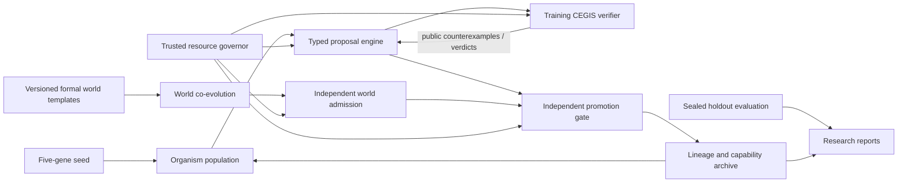

# CIN Mathematical Evolution: Integrated Research and Engineering Specification v0.5

**Status:** Proposed, not implemented. **Date:** 2026-10-18. **Source of truth for existing behavior:** the current `main` tree of `imMamdouhaboammar/code-in-nothing` and its tests; sandbox package restored from v0.4 archive. **Prerequisite:** [v0.4 integrated spec](2026-10-18-cin-integrated-system-spec-v0.4.md). **Navigation:** [docs index](../INDEX.md). **Engineering prompt:** [deep math agent mission](../prompts/DEEP-MATH-CODING-AGENT.md).

## A. Purpose and research question

CIN asks whether **model-free, hybrid-evolving program populations**, challenged by separately co-evolving **formally specified worlds**, can progressively acquire **provably correct (under declared proof scopes)** mathematical algorithms and reusable search knowledge. It must never infer 'greater intelligence' from code length, task ID changes, larger input bounds, or unaccounted verification work.

**North-star demonstration:** starting from the existing tiny integer seed, a series of independently evaluated cohorts eventually discovers, verifies, archives and transfers algorithms progressing from conditionals to composed numerical functions and, conditionally, a bounded Euclidean GCD algorithm. A later, separately gated experiment may attempt extended GCD with Bézout coefficients. These are **targets**, not claims, guarantees, or mandatory solutions. Entire cohorts may fail. Negative findings must be recorded.

### Research hypotheses (falsifiable)

- **M-H1 Capability:** On sealed mathematical relations not seen during selection, evolved populations solve more *semantically distinct* tasks per **total compute budget** than typed random search and a fixed grammar enumerator.
- **M-H2 Transfer:** Parent-approved abstractions reduce median or distributional time-to-solution on withheld related tasks relative to equivalent-cost no-inheritance controls, *including library discovery, admission, and validation overhead*.
- **M-H3 World adaptation:** Co-evolved worlds increase held-out task-family coverage over fixed worlds without increasing evaluator leakage, invalid tasks or reward hacking.
- **M-H4 Meta-adaptation:** A birth-gated driver policy yields measured improvements under matched controls, without regressions or modifying evaluator rules.
- **M-H5 Scaling:** For matched primitive sets and budgets, learned abstractions improve task-solve efficiency as the *minimum observed baseline search cost* of tasks increases. This is not the claim that generated programs get longer.

**Disproof:** A negative or inconclusive comparison, or superiority that disappears under complete resource accounting, rejects the relevant claim. No post-hoc benchmark selection.

## B. Anchored baseline and design discontinuities

| Dimension | Existing v0.1 behavior, verified by source | v0.5 proposed capability |
| --- | --- | --- |
| Genome | Exactly `base`, `driver`, `directive`, `maturity_point`, `stop_station` | Exactly five genes, unchanged; additional run metadata stays outside genes |
| IR | `Arg` restricted to indices 0/1; `ConstInt`; `Add/Sub/LessThan/Equal/If`, root `Int` | Versioned function signatures and typed composition; later controlled operator growth |
| Search | Deterministic bounded `candidate_stream` with leaf operators and limited conditionals | Cost-fair typed grammar enumeration, subtree variation, candidate dedup and compositional macros |
| World | `x,y` domain; `and/or/gte/lte/eq` formula DSL | Typed multi-input, unique-output formal relations with semantic lineage |
| Verification | Exhaustive finite-domain checks; private bounded witness admission | Finite proof + optional independent SMT counterexample/proof-scope checking |
| Evolution | One parent, one potential offspring with same MAX2 task under distinct ranges | Multi-generation, cross-task reuse and explicit world/spec novelty |
| Evidence | SHA-256 event chain, example output, 35-test historical baseline | Deterministic resumable manifests, complete compute ledger, blinded studies |

**Important:** `cin.search.candidate_stream` cannot synthesize arbitrary nested conditionals, loops, multiplication, GCD, or three-input algorithms today. Avoid any agent prompt that assumes it can. `run_ir` is **not** an OS sandbox. Existing finite-domain PASS is **not** a universal mathematical proof.

## C. Non-negotiable laws

Preserve CIN-I01 through CIN-I14 in [v0.4](2026-10-18-cin-integrated-system-spec-v0.4.md), plus:

1. **CIN-M01: Expressibility before difficulty.** Admit a benchmark to a synthesis cohort only if its required solution can be expressed in that cohort's versioned IR, or explicitly run it as a *capability-boundary negative test*.
2. **CIN-M02: Honest proof tags.** `FINITE_EXHAUSTIVE`, `BOUNDED_BITVECTOR`, `SMT_VALID` (theory, assumptions and solver result), `TESTED_ONLY`, `UNKNOWN` must never be conflated.
3. **CIN-M03: Unique or functionally determined task.** An admitted mathematical world requires precondition satisfiability and a functionally determined output for admissible inputs within its stated semantics. Merely mentioning `result` in a postcondition is insufficient.
4. **CIN-M04: No oracle injection.** World witness implementations, hidden solutions, holdout examples and SMT models cannot be input to the organism's generation policy. Error counterexamples may be fed back only from a designated *training* verifier, with budgets counted and final holdouts sealed.
5. **CIN-M05: Program length is descriptive, not fitness.** Acceptance requires correctness plus distinct function or measured efficiency/transfer improvements; bloat is penalized, not rewarded.
6. **CIN-M06: Counterexample cannot become a proof.** CEGIS trains on visible counterexamples; an independent final verifier checks the full declared domain/theory after convergence.
7. **CIN-M07: Explicit arithmetic semantics.** Integer division, remainder, sign, zero and overflow must be specified in versioned IR. `gcd(0,0)` and negative inputs need deliberate policy.
8. **CIN-M08: Program synthesis must not be outsourced uncredited to an admission solver.** Solvers may admit worlds or disprove proposed solutions, but solver-generated final programs must be labeled a distinct baseline, never counted as organic discovery.
9. **CIN-M09: Bounded execution.** New recursion/loops require independently enforced step/loop and memory limits and a verified termination obligation for the claimed proof scope; no arbitrary generated Python execution.
10. **CIN-M10: Five-gene identity and stop/maturity rules remain immutable during individual life.** Any policy mutation is proposed for an offspring and tested independently.

## D. Target architecture and ownership

**Trusted boundary:** immutable schema/semantics registry, independent verifier and holdout steward, resource governor, event store. **Untrusted boundary:** organism candidates, world proposals, evolution policies, generated code. Organism/world actors never import verifier-private artifacts.

**Existing modules must be reused first:** `cin/ir.py` owns typing and evaluation; `cin/search.py` owns proposals; `cin/worlds.py` owns world relations and evaluation; `cin/evolution.py` owns admission/promotions/lifecycle; `cin/contracts.py` owns schema validation; `cin/archive.py` owns evidence. Create a new module only when one clear responsibility cannot be represented cleanly inside the owner, and isolate the extension behind versioned adapters. Do not create a plugin/agent SDK, server, UI, distributed cluster or bespoke neural model for this milestone.

**Maturity:** distinct task-family transfer on sealed tasks and under total budget, not number of descendants, AST growth or expanded world range. **Death:** strict per-organism and global search ceilings, plateau and stop contract. Archived validated skills may persist after death.

## E. Synthesis algorithm proposal

1. Declare a **typed, versioned grammar** `G_k` with arity, integer semantics, maximum AST depth/nodes and primitive computational costs. Start by proving compatibility with current two-argument IR.
2. Generate ASTs bottom-up by total structural cost, with fair progress across production rules; do not enumerate all huge templates before exploring smaller alternatives. Run strict typing and budget checks before evaluation.
3. Reject exact duplicates using canonical IR hashes; where safe, cache **observational equivalence** only on training inputs and retain a representative. Do **not** substitute observational equality for mathematical equivalence. Reevaluate when new counterexamples appear.
4. Obtain training counterexamples from the *visible* verifier. CEGIS refines the candidate observational set but never sees final hidden holdouts or solver-private witness code.
5. Promote an accepted function only after independent whole-domain/theory checking for its specified proof scope and regression replay for depended-on skills. `UNKNOWN` never advances maturity.
6. Extract simple typed macros by discovering repeated subtrees of accepted solutions. Only expose a macro to a child after dependency closure and actual regeneration/replay tests. Prove a measurable gain against macro-disabled control; include extraction cost.
7. Apply structural mutations to previously accepted solutions, and select candidates with quality-diversity criteria using **independently observable semantic features**. Avoid identical MAX2 functions counting multiple times across domains.
8. Only after the above holds, test birth-gated, versioned search-policy variation against an unchanged control. New operators can be proposed *as grammar migrations*, not injected dynamically into an active verifier.

**Alternatives considered:**

- Full SMT/SyGuS synthesis as the organism: excellent baseline, but confounds the claim that the *organism* independently discovers solutions; use it as comparison and verifier where appropriate.
- Direct evolutionary mutation of unrestricted Python: much broader expressibility but unacceptable code-execution and attribution risk; rejected until a separate OS isolation review.
- Full DreamCoder clone or neural search: extra complexity and the reference work uses neural guidance; start with symbolic-only abstraction extraction instead.
- E-graphs immediately: useful once duplicate-equivalence measurements justify them; don't add `egg` or another runtime until a documented search bottleneck and differential tests exist.

## F. Escalating mathematical problem ladder

A challenge is **not** 'harder' because its numeric values got bigger. Difficulty is **measured** using predefined held-out tasks and equal-budget baseline solving cost.

| Tier | Task | Target mathematical contract | Prerequisite | Proof expectation | Prohibited shortcut |
| --- | --- | --- | --- | --- | --- |
| 0 (implemented) | `max2(x,y)` | `r >= x`, `r >= y`, `r=x or r=y` | Current typed IR | finite exhaustive | count range growth as novelty |
| 1 | `min2`, `absdiff(x,y)` | `r=min(x,y)`; `r >= 0` and `r=x-y or r=y-x` with correct branch | Deep composed expressions/search | independent finite domain + counterexamples | use reference result as candidate |
| 2 | `median3(x,y,z)`, `clamp(x,lo,hi)` | median equals middle order statistic; clamp respects `lo <= hi` | variable-arity typed signatures, deeper nested conditionals | finite exhaustive, LIA SMT optional | add `median`/`clamp` primitive |
| 3 | `piecewise(x,y)` with 3+ regions and affine branches | unique formula across all regions including boundaries | compositional reuse, larger AST budget | finite + SMT linear arithmetic if applicable | hardcode finite lookup |
| 4 | `gcd(a,b)` via Euclid | `g>=0`; `g | a`, `g | b`; greatest common divisor, including zeros | division/modulo with specified semantics, bounded loops/termination | bounded exhaustive initially; stronger proof separately | add built-in `Gcd` op or solver solution |
| 5 (research stretch) | `extended_gcd(a,b)` | output triple `(g,s,t)` with `s*a+t*b=g`, canonical `gcd`; termination | typed tuples/state, loops, invariants | bounded first; proof obligations for invariant/termination | preload Euclid body in seed |

**Notes:** Level 1 `absdiff` must prove which signed difference to choose; a postcondition that only says `r >= 0` is inadequate. Level 2's functional signature change is **a schema and IR migration**, not merely adding a world fixture. Level 3 should use a fixed public family definition with withheld instance parameters. Level 4's `g | a` includes the zero conventions; divisibility and greatestness require a sound executable checking strategy or formal logic, not a few examples. Finite-domain checks certify *only* the finite domain. Level 5 tuple outputs require new type semantics.

## G. Formal worlds and oracle separation

Each proposed `WorldSpec/v0.2` should encode immutable: world content hash; parent world hash; grammar/protocol version; signature with named typed inputs and output; precondition; postcondition or relation; finite/SMT proof scope; explicit semantic task family; origin template and version; resource ceilings. The world may be generated from **restricted declarative relation templates**, not arbitrary Python expressions.

**Admission conditions:** (1) schema and type check; (2) satisfiable precondition; (3) satisfiable postcondition for each allowed input under declared proof scope; (4) unique output or explicit relational multi-output policy; (5) representability analysis for cohort grammar, with `UNKNOWN` rather than rejection when incompleteness blocks conclusion; (6) semantic novelty/equivalence check against archive; (7) hard budget accounting. An optional reference witness is **verifier-private**; it must not become a proposed program.

When checking **finite domains**, explicitly define the finite output domain or use proof-backed uniqueness; enumerating candidate results over an arbitrary fixed range without warrant cannot establish uniqueness. When using SMT, `unsat` for `precondition AND (candidate_output != allowed_output)` under a supported theory is a sound result only if encoding and translation are sound. Solver `unknown` never counts as `unsat`. Use version-pinned cvc5 *base Solver API* if selected; its **Pythonic API explicitly lacks SyGuS**, so verify signatures before coding.

**Counterexample flow:** return input and failing property to the training search; redact the reference program. Keep sealed mature/holdout tests on a separate path with no callback to proposals. Two cohorts may use distinct training counterexamples but must face the identical frozen withheld evaluation protocol.

## H. Resource and evidence contracts

Metrics must meter: generated AST attempts including invalids; static-check cost; interpreter node operations; world witness proposals/evaluations; training counterexample search; external SMT solver CPU/wall time; abstraction mining/replay; births/deaths; serialization, checkpoint and retry overhead; failed/unknown verdicts. Report hardware, interpreter and solver versions; count admission and verifier work in shared total cost. Compare primary performance under compute-equivalent conditions; proposal count alone is not enough.

Persist artifact identity with schema/grammar/evaluator/version hashes, world semantics, birth parent DAG, all accepted dependencies, candidate tree, certificate, counterexample scope, stop reason. Resume requires deterministic RNG state and atomic or recoverable event/checkpoint transitions. Existing JSONL hash chain detects simple mutation only; do not call it cryptographically authentic.

## I. Experimental protocol and decision gates

1. Preregister task-family splits, generators, grammar/operator versions, output semantics, budgets, random seeds, checks, primary metric and analysis script **before** comparative runs.
2. Research arms: `R0` uniform typed random; `R1` cost-fair typed enumerator; `R2` CEGIS but no inheritance; `R3` inheritance with frozen worlds; `R4` co-evolving worlds with fixed driver; `R5` co-evolving + inheritance + birth-gated policy search. All pay full search and evaluation costs.
3. Primary endpoints: independent withheld **semantic** tasks solved per total normalized compute, and distribution of compute-to-correct-solution with unsolved runs censored at budget. Report proof-scope labels and confidence/uncertainty; treat each random seed/cohort as independent unit.
4. Secondary: generalized task-family coverage, average AST cost of correct solutions, valid-world yield, abstraction reuse count, negative transfer/regressions, solver `UNKNOWN`, timeout, energy/CPU diagnostics and journal replay success.
5. Engineering smoke tests may run with 3-5 seeds, but confirmatory study sample size must be set from observed variance/precision and run manifest; never claim statistical support from one cherry-picked seed.
6. Capture *failure* as evidence. No benchmark tuning against sealed holdout. Any verifier/grammar version change starts a new cohort; don't mix reports.

### Stop/go criteria

- **G1 Search:** at least two non-MAX2 function relations produced, verified and exported under finite scope; search baseline comparison reproducible. If not, repair grammar/search instead of adding worlds.
- **G2 Semantic worlds:** at least three genuinely different admitted relations, with explicit equivalence tests including range-only duplicates; rejected and `UNKNOWN` preserved.
- **G3 Transfer:** an inherited abstraction is selected as part of a correct solution in at least two distinct semantic relations, with full replay and measured controls. Mere copied `max2` is not transfer.
- **G4 Complex math:** median3 and a multi-branch affine relation demonstrably solved before introducing loops/SMT proof complexity.
- **G5 Euclid:** GCD under a frozen finite domain with explicit zero, negative and termination boundaries; no universal correctness claim until stronger obligations pass.
- **G6 Meta/science:** matched-budget controls show, or fail to show, a preregistered improvement with uncertainty estimates. Publish negative results.

## J. Implementation order, compatibility and rollback

Follow [deep math phase plan](../plans/2026-10-18-cin-deep-math-phases.md). Sequence: measure current baseline; refactor search behind a compatibility seam; implement tier-1 relations; add versioned typed N-ary function signatures; world admissibility/uniqueness; abstraction reuse; multiple generations/checkpoint and driver adaptation in dependency-safe order; tier-2/3 proof evaluation; only then optional loops, Euclid and extended GCD. Existing `cin.genome/v0.1` and `cin.world/v0.1` artifacts remain parseable. Never silently reinterpret existing hashes or rewrite preserved experiment journals. Any new `.schema.json` must have both positive/negative fixtures and versioned docs.

Do not raise existing resource ceilings to obtain a passing demo without accounting. Avoid needless dependencies until an evidenced bottleneck exists. Keep a unit-tested, independently executable slice per phase, and publish reproducible artifacts and the limitation of each proof.

## K. Research grounding

See [annotated research](../research/MATH-SYNTHESIS-RESEARCH.md) and [benchmark protocol](../research/MATH-BENCHMARK-PROTOCOL.md). The cited literature motivates particular mechanisms; none establishes that CIN already discovers arbitrary algorithms, proves universal properties, or is intelligent in a human sense.
